# YotoBookMaker for Windows

A native Windows 11 app for getting audio onto your [Yoto](https://yotoplay.com) player — split an audiobook into chapters, upload a folder of audio files as a playlist, or make cards that stream podcasts and live radio.

> **Independent tool — not affiliated with or endorsed by Yoto Limited.**

 

Also available for **[macOS →](https://github.com/bbenkle/YotoBookMaker)**

---

## Download & Install

1. Go to the [Releases](../../releases) page and download the latest `Setup.exe`
2. Run it — no admin rights or UAC prompt required
3. A Start Menu shortcut is created automatically

On first launch you'll be shown a brief Terms of Use — click **Accept** to continue.

> **Portable option:** a `.zip` is also available on the Releases page if you prefer to run the app without installing it. Extract to any folder and double-click `YotoBookMaker.exe`.

## Requirements

- Windows 10 (1903 or later) or Windows 11
- No additional software required — ffmpeg is bundled with the app
- An internet connection for uploading, podcast and radio search, and sign-in

> **Note:** On Windows 10 the window background will be a solid color rather than the translucent Mica effect used on Windows 11. All features work identically.

---

## Workflows

Pick a workflow on the welcome screen. **Choose Workflow** at the top of the sidebar takes you back there at any time.

| Workflow | What it does |
|---|---|
| [**Audiobook**](#audiobook-workflow) | Split one audiobook file into chapters, add icons, and upload it as a card. |
| [**Playlist**](#playlist-workflow) | Upload a folder of audio files as a playlist — no splitting. |
| [**Batch split**](#batch-split-workflow) | Split a whole folder of audiobooks at once. No upload. |
| [**Podcast**](#podcast-workflow) | Make a card that streams episodes from a podcast feed, and refresh it later. |
| [**Radio**](#radio-workflow) | Make a card that streams live radio stations. |

Icons and uploading work the same in every workflow that uses them — see [Icons](#icons) and [Uploading to Yoto](#uploading-to-yoto).

---

## Audiobook workflow

### 1 — Select your audiobook

Drop an audiobook file onto the window or click **Browse Files**. The book title, author, and cover image are read automatically from the file's embedded metadata, and the app moves on to **Configure** as soon as the file has been read.

**Supported formats:** M4B · M4A · MP3 · MP4 · WAV · AAC

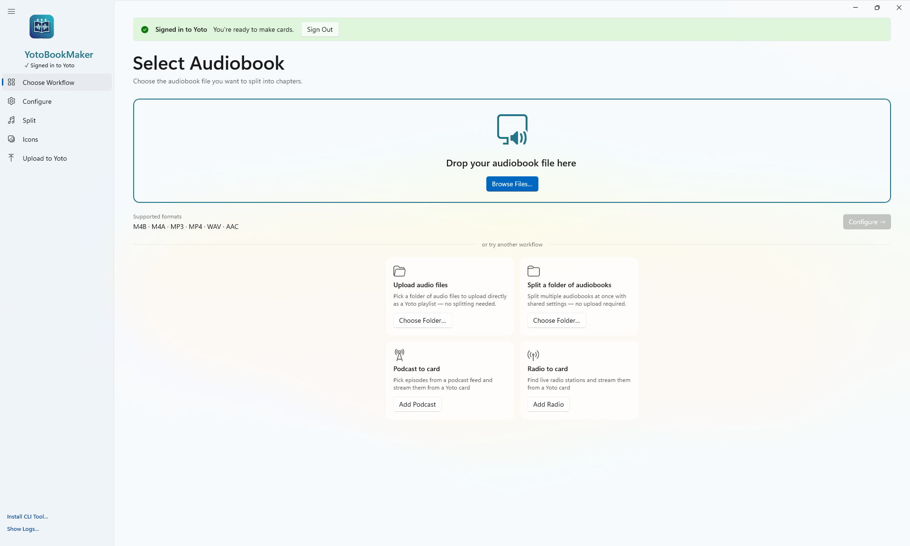

### 2 — Configure

Choose how chapters should be detected and pick your export settings.

**Chapter detection methods:**

| Method | When to use |
|---|---|
| **Embedded Metadata** | Best choice — works with most M4B files from Audible, iTunes, Libro.fm, etc. Instant and accurate. |
| **Silence Detection** | For files with no chapter markers. Finds chapter breaks by analyzing gaps in the audio. Not suitable for full-cast productions or books with continuous background music. |
| **JSON Timestamps** | Provide a JSON file with exact start times if you need full manual control. |

**Export options:**

| Setting | Options |
|---|---|
| Format | M4A · M4B |
| Bitrate | **Original** (default — no re-encoding) · 32 · 64 · 96 · 128 · 192 kbps |
| Mono | Off by default — stereo output. Turn on if you prefer mono. |
| Create subfolder | On by default — creates a `<title>_chapters` folder inside the output location you choose. Turn off to save files directly in the chosen folder. |
| Upload to Yoto after splitting | On by default. Turn off to split only — useful if you want to process the files yourself first. |

**Yoto has a maximum upload size of 500 MB for Make Your Own Playlist.** Please use the size estimator to find the correct export settings for your book.

The estimated export size is shown before you split. When using **Original** quality, the size matches your source file exactly.

#### Silence detection sensitivity

| Level | Best for |
|---|---|
| **Low** | Expressive narrators with dramatic pauses — conservative, only fires on long quiet gaps (≥ 5s) |
| **Medium** | Most professionally produced audiobooks — balanced default |
| **High** | Recordings with slight background noise or music fades — more sensitive, may produce extra splits |

#### JSON Timestamps format

If you choose **JSON Timestamps**, browse to a `.json` file containing your chapter list. The file is validated immediately on selection — you'll see the chapter count (or a specific error) before you proceed.

Each entry needs a title and a start/end time:

```json
[
  { "title": "Opening Credits", "start": "0:00:00", "end": "0:05:42" },
  { "title": "Chapter 1",       "start": "0:05:42", "end": "0:38:17" },
  { "title": "Chapter 2",       "start": "0:38:17", "end": "1:11:04" }
]
```

Times use `H:MM:SS` or `M:SS` format. Milliseconds are also supported (`start_ms` / `end_ms`). An [example file](https://github.com/bbenkle/YotoBookMaker/blob/main/example-chapters.json) is available in the Mac repository.

> **Tip:** if you've already split an audiobook using the Metadata method, the `_chapters.json` file it produces can be used directly as input for JSON detection on another file.

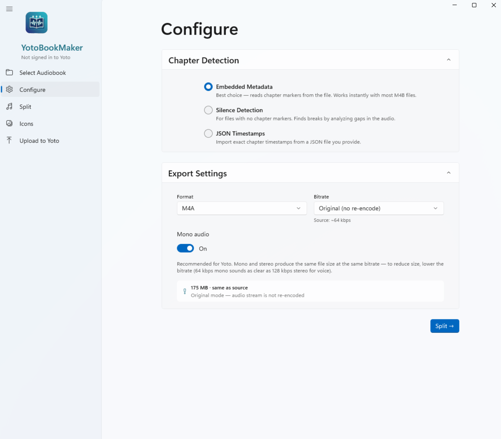

### 3 — Split

Click **Start Splitting**. A live log shows what's happening as each chapter is detected and exported, along with an elapsed timer. The chapter list stays on screen after splitting so you can review results, and you can re-run with different settings at any time.

Once splitting is complete, a **Move Original to Recycle Bin** button appears if you want to clean up the source file.

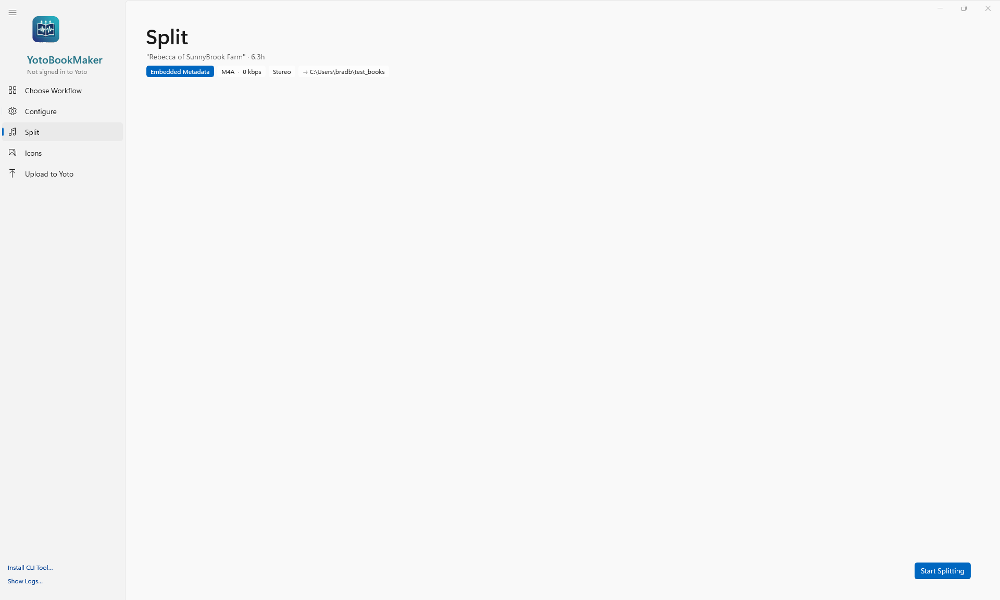

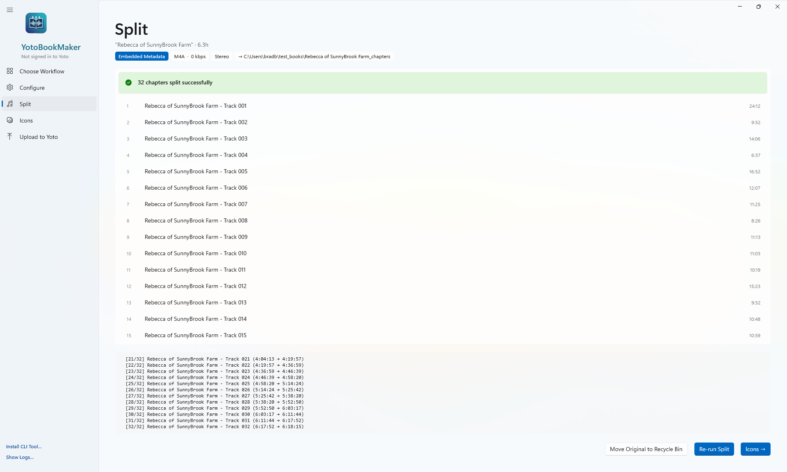

### 4 — Icons

Give each chapter an icon — see [Icons](#icons).

### 5 — Upload

Sign in and upload — see [Uploading to Yoto](#uploading-to-yoto). If your audiobook file has embedded cover art, it is pre-filled as the card's cover image.

[↑ Back to workflows](#workflows)

---

## Playlist workflow

Click **Choose Folder…** on the **Upload audio files** card on the welcome screen. Pick any folder of audio files — music, narration, existing chapter splits, or any other content.

Track titles are read from each file's embedded metadata and fall back to the filename if none is found.

### 1 — Playlist Setup

Review the track list loaded from your folder. You can:

- **Edit track titles** — click any title to change it
- **Reorder tracks** — drag rows into the order you want
- **Remove tracks** — click the trash icon on any row
- **Add more files** — click **Add Files…** to include audio files from other locations
- **Set the playlist name** — used as the title when uploading to Yoto

### 2 — Icons

See [Icons](#icons).

### 3 — Upload

See [Uploading to Yoto](#uploading-to-yoto).

[↑ Back to workflows](#workflows)

---

## Batch split workflow

Click **Choose Folder…** on the **Split a folder of audiobooks** card on the welcome screen. The app scans for audio files and shows the count before you start.

### 1 — Batch Settings

Configure shared output settings for all books in the folder:

| Setting | Options |
|---|---|
| Search subfolders | Off by default. Turn on to scan the entire folder tree instead of just the top level — useful for collections organized as one folder per book (e.g. `Author\Series\Book Title\audio.m4b`). The app's own `<title>_chapters` output folders and hidden files/folders are skipped automatically. Toggling triggers an immediate rescan. |
| Format | M4A · M4B |
| Bitrate | **Original** (default — no re-encoding) · 32 · 64 · 96 · 128 · 192 kbps |
| Mono | Off by default — stereo output. Turn on if you prefer mono. |
| Create subfolder | On by default — creates a `<title>_chapters` folder next to each source file. Turn off to save chapters directly in the same folder as the source file. |
| Move original to Recycle Bin | Off by default. Turn on to move each source file to the Recycle Bin after it is successfully split. |

Chapter detection always uses **Embedded Metadata** in batch mode — silence detection and JSON timestamps require per-file configuration and are not available.

### 2 — Batch Split

Each audiobook is processed one at a time. A row per book shows its status (queued → splitting → done / failed), a live progress bar, and the chapter count on completion.

Use **Cancel** to stop after the current book finishes. A summary is shown when the batch completes.

[↑ Back to workflows](#workflows)

---

## Podcast workflow

Click **Add Podcast** on the **Podcast to card** card on the welcome screen. Podcast cards **stream** each episode from the podcast's own servers: nothing is downloaded, and only the cover and icon are uploaded to Yoto. Episodes play only while the player is online, and new episodes aren't added by themselves — use **Refresh a Card** for that.

> We can't verify podcast content. A red **E** marks shows and episodes their publishers have flagged as explicit, but many aren't flagged — and an unflagged show isn't necessarily suitable for children. Please listen before putting a podcast on a child's card.

### New Card

1. **Find the podcast** — type a name and click **Search** (Apple Podcasts), or paste the show's RSS feed URL and click **Load Feed**. In search results, check the author and episode count to pick the official show.
2. **Pick episodes** — the newest episodes are listed first.
   - **Latest [N] episodes** — type a number from 1 to 100 (or use the arrows) to select that many of the newest episodes. Anything else shows **Enter 1–100**.
   - **Select All** (up to 100, the most a card holds) and **Clear**, or tick episodes one by one.
3. **Options** (remembered between sessions):
   - **Oldest first on card** — on: track 1 is the oldest episode you picked, so a series plays in order. Off: track 1 is the newest — handy for news.
   - **Resolve tracking redirects** — saves each episode's final audio address instead of an ad-tracking link. Leave it off unless episodes won't play; some hosts' final addresses expire.
4. **Create Yoto Card** — the show's artwork becomes the card cover and the chapter icon.

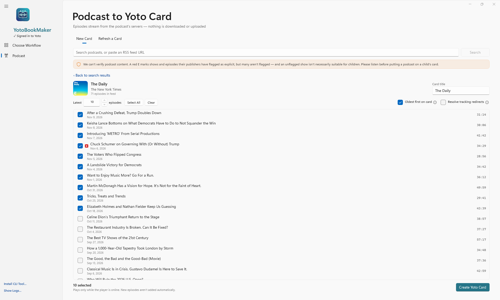

### Refresh a Card

Switch to **Refresh a Card** to update an existing podcast card with the newest episodes from its feed — the same card, with its title and cover kept. It's the app's version of the Refresh button on Yoto's website.

- **Keep the latest [N] episodes** — 1 to 100 (Yoto's own Refresh keeps 30).
- **Your podcast cards** lists cards with a saved feed URL. Click **Refresh** on one and confirm.

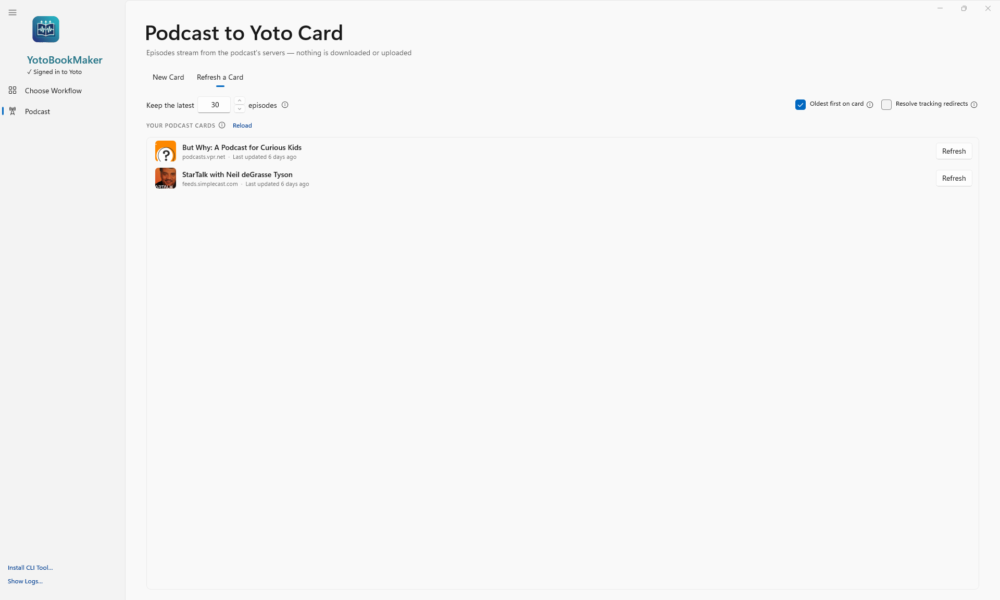

[↑ Back to workflows](#workflows)

---

## Radio workflow

Click **Add Radio** on the **Radio to card** card on the welcome screen. Radio cards stream live from each station, and play only while the player is online.

1. **Find stations** — search the community [Radio Browser](https://www.radio-browser.info) directory by name, or paste a stream or playlist URL (`.pls`, `.m3u`, `.m3u8`).
2. **Add stations** — each one is **checked automatically** when added, so you'll see if a stream is offline or in a format the player may not support (for example HLS).
3. **Arrange the card** — drag stations into order and rename them. The **card title** and **cover** follow the first station (the cover uses the station's logo when a good-sized one is available).
4. **Create Yoto Card.**

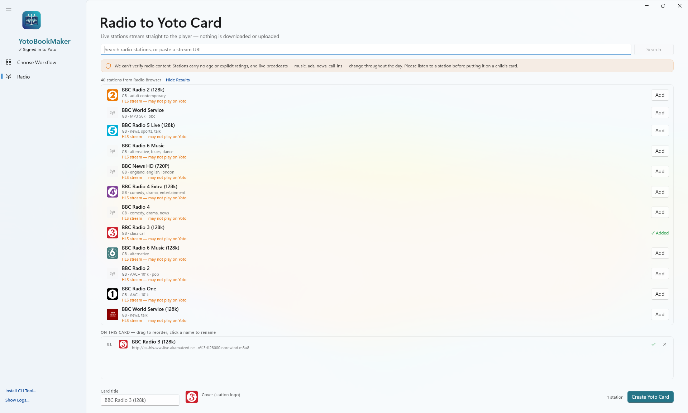

[↑ Back to workflows](#workflows)

---

## Icons

Each chapter or track gets a 16×16 pixel icon on the player. Icons are generated entirely on your PC — no internet needed.

### Generated icons

- **Generate All** — a color-coded icon for every chapter, with the chapter number in a pixel font sized to fit one, two or three digits.
- **Randomize All** — a unique random color scheme for every chapter. You choose **All Animated (GIF)**, **All Still**, or a **Mix of Both**.
- **Per-chapter style** — click a chapter to pick colors, pattern, and **animation**.

### Animated icons

Generated icons can move: **Scroll** (the pattern slides), **Orbit** (the dots circle the number), **Twinkle** (the dots blink) and **Pulse** (the background glows). Animated icons are uploaded as 16×16 GIFs.

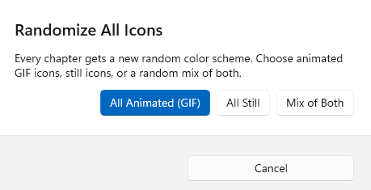

### Your own images

- **Per chapter** — click a chapter and choose an image (PNG, JPEG, or GIF).
- **Import Icons** — choose a folder of images; they're matched to chapters by the number in the filename (e.g. `ch-01.png`, `Chapter 22.gif`).

**GIF rules:**
- A GIF that is already **16×16** is used exactly as it is, animation and all.
- Any other size prompts you to **Auto-Resize** it to 16×16 (keeping its frame timing and looping), or skip it. Pixel-art GIFs whose size is a multiple of 16 stay sharp; other GIFs are smoothly scaled.
- A single-frame GIF is treated like a still image.

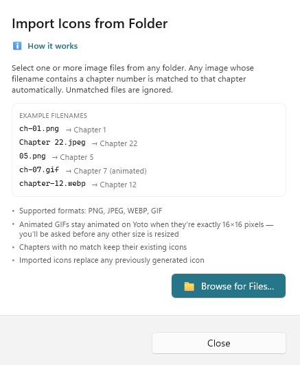
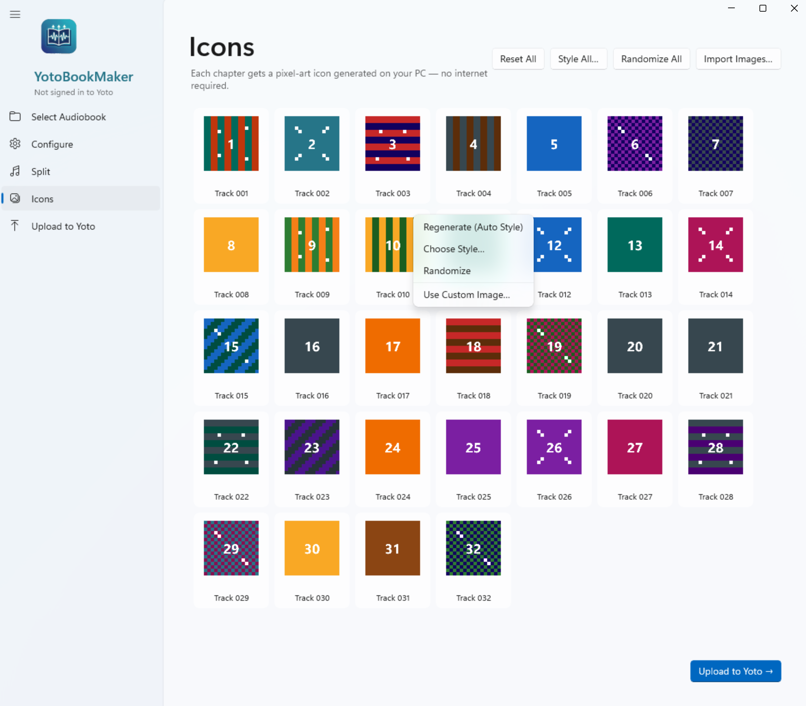

---

## Uploading to Yoto

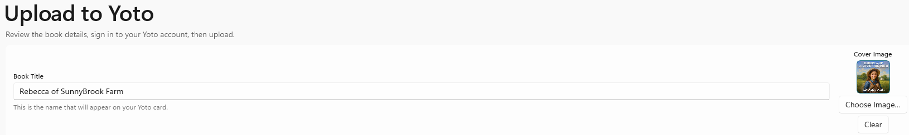

### Signing in

You can sign in from the banner at the top of the welcome screen, or from the Upload, Podcast or Radio page.

1. Click **Sign in to Yoto**, then **Continue**. Yoto's sign-in page opens in your browser.
2. Sign in, then click **Accept** on Yoto's **Authorize App** page.
3. When the page says **You're signed in**, switch back to the app — it finishes signing in by itself. There's no code to copy, and your password is never entered into the app. **Open Browser Again** reopens the page if you closed it.
4. Click **Upload to Yoto** and the app handles the rest: uploading audio, icons, and creating a ready-to-play playlist on your card.

> **"This app is not verified by Yoto"** — you'll see this warning on the Authorize App page. It's expected: Yoto only verifies third-party apps once they have an established base of regular users, so new apps like this one show it for now. YotoBookMaker asks only to manage your Make Your Own content and to stay signed in. The page also lists "account details, including email address, region and language" — YotoBookMaker doesn't ask for these, and never reads or stores them.

Your sign-in is saved securely in **Windows Credential Manager**, so you only need to do this once. To sign out, click **Sign Out** on the welcome screen's banner or the Upload page.

> Sign-in uses port **8787** on your PC to receive Yoto's answer. If another app is using it, you'll see a message asking you to quit other apps that might be signing in to Yoto.

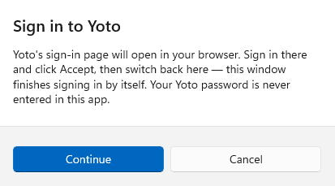
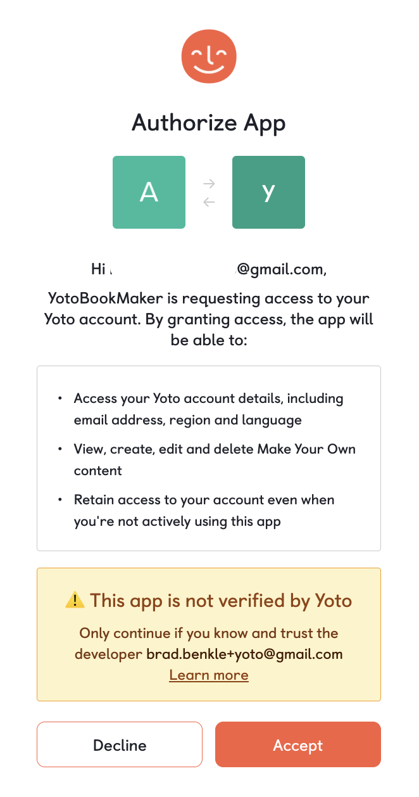
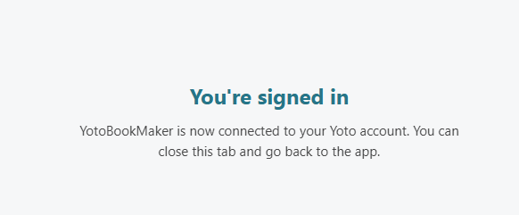

### Uploading

Set the card title and cover image (embedded cover art is pre-filled; replace or clear it with **Choose Image…**), then click **Upload to Yoto**. The app uploads each chapter's audio and icon, waits for Yoto to process it, and creates a ready-to-play card.

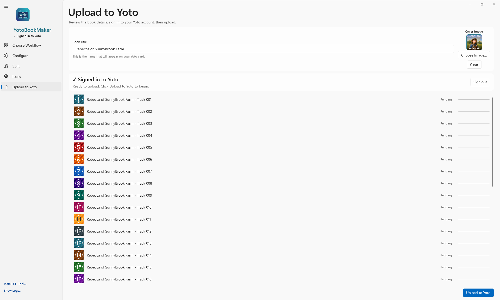

### Retrying failed uploads

If some chapters fail, you don't need to upload the whole book again:

- Click **Retry** next to a failed chapter to upload just that chapter.
- The main button changes to **Retry N Failed Chapters** (or **Upload N Remaining** if you cancelled) and only uploads what's missing.
- Every retry adds the chapters to **the same card** — you won't end up with a second one.
- If every chapter uploaded but the card wasn't created, **Create Card** finishes the job without re-uploading anything.
- **Cancel** stops after the current chapter. Chapters already uploaded are kept until you start a new project.

---

## Logs

Each app session writes a timestamped log file to `%LocalAppData%\YotoBookMaker\logs\`. Click **Show Logs…** at the bottom of the sidebar to open that folder in Explorer.

---

## CLI tool (yotosplit)

`yotosplit.exe` is a command-line tool bundled with the app. It exposes the same audiobook splitting engine so you can script or automate splits without opening the GUI.

### Setup

After installing the app, click **Install CLI Tool…** in the sidebar to get a PowerShell command that adds the install folder to your `PATH`. Once done, `yotosplit` is available in any terminal.

Or run it directly from the install folder (default: `%LocalAppData%\YotoBookMaker\`).

### Usage

```
yotosplit --input <path> [options]
```

### Flags

| Flag | Default | Description |
|---|---|---|
| `--input <path>` | — | Input audiobook file (M4B · M4A · MP3 · MP4 · WAV · AAC) — mutually exclusive with `--folder` |
| `--folder <path>` | — | Folder of audiobooks — splits all audio files using embedded metadata only (silence/JSON not available in folder mode) |
| `--output <path>` | next to input | Output directory |
| `--method <method>` | `metadata` | `metadata` · `silence` · `json` (ignored in `--folder` mode) |
| `--format <fmt>` | `m4a` | `m4a` · `m4b` |
| `--bitrate <kbps>` | `original` | `original` · `32` · `64` · `96` · `128` · `192` |
| `--mono` / `--no-mono` | mono on | Mono downmix (recommended for Yoto) |
| `--no-subfolder` | subfolder on | Save directly in output dir instead of a `<title>_chapters` subfolder |
| `--silence-threshold <dB>` | `-50.0` | Silence threshold in dBFS (silence detection only) |
| `--min-silence <seconds>` | `2.0` | Minimum silence gap (silence detection only) |
| `--json-file <path>` | — | JSON timestamp file (required for `--method json`) |
| `--trash` | off | Move original to Recycle Bin after a successful split |
| `--help` | — | Show usage |

### Output

Progress and log messages are written to **stderr**. On success, each chapter is printed to **stdout** as a tab-separated line:

```
1	Chapter 1	C:\output\01_Chapter_1.m4a
2	Chapter 2	C:\output\02_Chapter_2.m4a
```

This makes it easy to pipe the chapter list into other tools.

**Exit codes:** `0` = success · `1` = error

### Examples

```powershell
# Split using embedded metadata (default), mono M4A, original quality
yotosplit --input "MyBook.m4b"

# Silence detection, 64 kbps, save directly in C:\output
yotosplit --input "MyBook.mp3" --method silence --bitrate 64 --output C:\output --no-subfolder

# JSON timestamps, M4B format, move original to Recycle Bin when done
yotosplit --input "MyBook.m4b" --method json --json-file chapters.json --format m4b --trash

# Split every audiobook in a folder (uses embedded metadata for all files)
yotosplit --folder "C:\Audiobooks"
```

---

## Updates

The app checks for new releases automatically on launch. When an update is available, a badge appears in the sidebar with a link to the release page.

**To update:**
1. Click the update badge in the sidebar — it opens the GitHub release page
2. Download the new `Setup.exe` and run it over your existing installation
3. No uninstall step is needed — the installer detects the previous version and replaces it in place
4. No UAC prompt — the app installs per-user, so no administrator rights are required

**What is preserved across updates:**
- Your Yoto sign-in — stored in Windows Credential Manager, never touched by the installer. (Updating to 1.5.0 from an earlier version asks you to sign in once more, because of the new Yoto sign-in.)
- Terms acceptance and podcast preferences — stored outside the app files, unaffected by reinstallation

**Upgrading from a ZIP install (v1.2.0 and earlier):** the old ZIP release had no installer, so the new `Setup.exe` cannot detect it automatically. Run `Setup.exe` and accept the default install path — it points to the same folder the ZIP used (`%LocalAppData%\YotoBookMaker\`). The installer only copies application files; it never deletes files it did not place there, so your logs and any other existing data in that folder are preserved. Future updates will upgrade silently with no prompts.

---

## Privacy

| | |
|---|---|
| Audio splitting | Stays entirely on your PC (via bundled ffmpeg — no network calls) |
| Cover art extraction | Stays entirely on your PC (via bundled ffmpeg — no network calls) |
| Icon generation | Stays entirely on your PC |
| Yoto sign-in | Happens on Yoto's own page in your browser. The app only keeps the sign-in tokens, in Windows Credential Manager — never your password, email, or account details |
| Upload | Sent to Yoto's servers — only when you click Upload or Create Yoto Card |
| Podcast search | Your search words are sent to Apple's iTunes Search API |
| Podcast feeds and episodes | Fetched from each podcast's own host. On the card, episodes stream from that host to your player. |
| Radio search | Your search words are sent to the community-run Radio Browser directory |
| Radio stations | Each station's server is contacted to check its stream and fetch its logo. On the card, the station streams to your player. |
| Update check | Sends a read-only request to the GitHub Releases API — no personal data |

The app has no server of its own and collects nothing. No analytics. No telemetry. Your Yoto account details are never sent to any of these services. Preferences (`%LocalAppData%\YotoBookMaker\settings.json`) and logs stay on your PC.

---

## Disclaimer

YotoBookMaker is an independent, community-built tool. It is **not affiliated with, endorsed by, or supported by Yoto Limited**. Yoto, the Yoto logo, and Yoto Player are trademarks of Yoto Limited.

Only upload audio content you own or have the legal right to use — such as DRM-free audiobook purchases or public domain recordings. Do not upload commercially licensed content without the rights holder's authorization.

Podcast and radio cards stream content published by others; YotoBookMaker doesn't host, check, or control it.

---

## License

MIT — see [LICENSE](LICENSE) for details.
