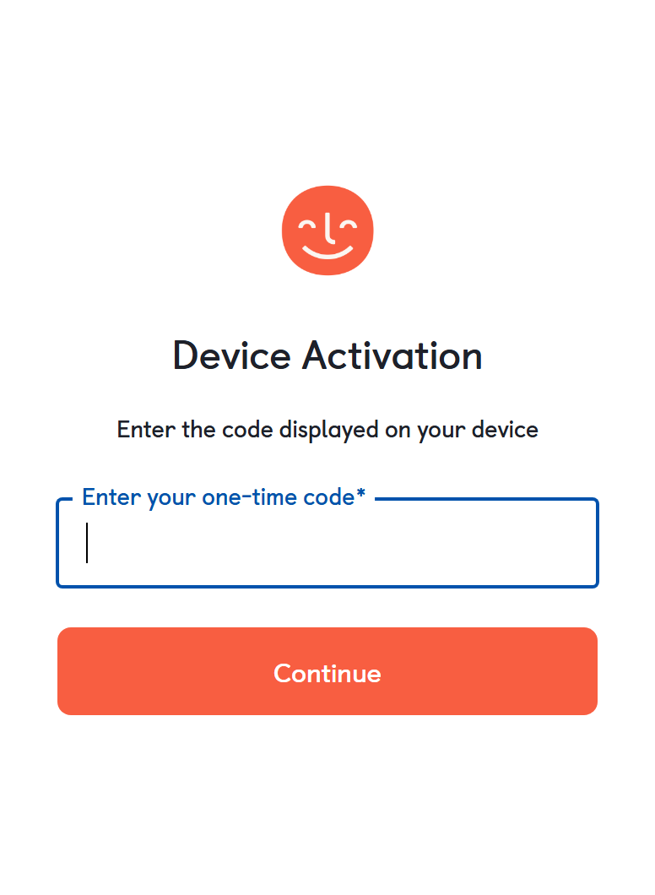
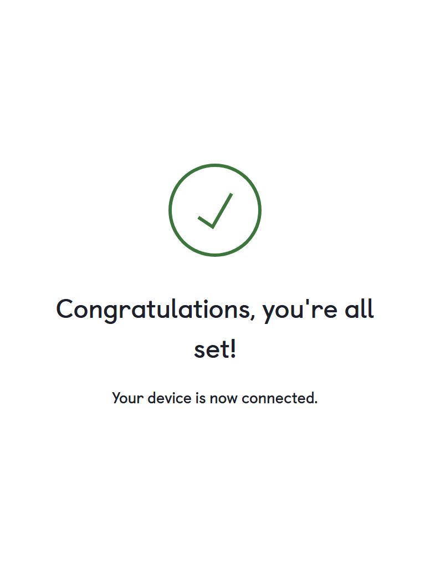

# YotoBookMaker for Windows

A native Windows 11 app that splits audiobook files into individual chapter tracks and uploads them directly to your [Yoto](https://yotoplay.com) Playlists.

> **Independent tool — not affiliated with or endorsed by Yoto Limited.**

 

Also available for **[macOS →](https://github.com/bbenkle/YotoBookMaker)**

---

## Download & Run

1. Go to the [Releases](../../releases) page and download the latest `.zip`
2. Extract the ZIP to any folder (e.g. `C:\Apps\YotoBookMaker\`)
3. Double-click **`YotoBookMaker.exe`** to launch — no installation required

> **Tip:** right-click `YotoBookMaker.exe` → **Pin to Start** or **Pin to taskbar** so you can find it easily next time.

On first launch you'll be shown a brief Terms of Use — click **Accept** to continue.

---

## What it does

Yoto cards support custom audio content, but loading a full audiobook requires splitting it into individual chapter files and uploading each one. YotoBookMaker handles the entire process in five guided steps.

---

## Requirements

- Windows 10 (1903 or later) or Windows 11
- No additional software required — ffmpeg is bundled with the app

> **Note:** On Windows 10 the window background will be a solid color rather than the translucent Mica effect used on Windows 11. All features work identically.

---

## How to use it

### 1 — Select your audiobook

Drop an audiobook file onto the window or click **Browse Files**. The book title, author, and cover image are read automatically from the file's embedded metadata.

**Supported formats:** M4B · M4A · MP3 · MP4 · WAV · AAC


---

### 2 — Configure

Choose how chapters should be detected and pick your export settings.

**Chapter detection methods:**

| Method | When to use |
|---|---|
| **Embedded Metadata** | Best choice — works with most M4B files from Audible, iTunes, Libro.fm, etc. Instant and accurate. |
| **Silence Detection** | For files with no chapter markers. Finds chapter breaks by analyzing gaps in the audio. Not suitable for full-cast productions or books with continuous background music. |
| **JSON Timestamps** | Provide a JSON file with exact start times if you need full manual control. |

**Export options:**

| Setting | Options |
|---|---|
| Format | M4A · M4B · WAV |
| Bitrate | **Original** (default — no re-encoding) · 64 · 96 · 128 · 192 kbps |
| Mono | On by default — recommended for Yoto |

**Yoto has a maximum upload size of 500 MB for Make Your Own Playlist.** Please use the size estimator to find the correct export settings for your book.

The estimated export size is shown before you split. When using **Original** quality, the size matches your source file exactly.

#### Silence detection sensitivity

When using silence detection, choose a sensitivity level that suits your recording:

| Level | Best for |
|---|---|
| **Low** | Expressive narrators with dramatic pauses — conservative, only fires on long quiet gaps (≥ 5s) |
| **Medium** | Most professionally produced audiobooks — balanced default |
| **High** | Recordings with slight background noise or music fades — more sensitive, may produce extra splits |

#### JSON Timestamps format

If you choose **JSON Timestamps**, browse to a `.json` file containing your chapter list. The file is validated immediately on selection — you'll see the chapter count (or a specific error) before you proceed.

Each entry needs a title and a start/end time:

```json
[
  { "title": "Opening Credits", "start": "0:00:00", "end": "0:05:42" },
  { "title": "Chapter 1",       "start": "0:05:42", "end": "0:38:17" },
  { "title": "Chapter 2",       "start": "0:38:17", "end": "1:11:04" }
]
```

Times use `H:MM:SS` or `M:SS` format. Milliseconds are also supported (`start_ms` / `end_ms`). An [example file](https://github.com/bbenkle/YotoBookMaker/blob/main/example-chapters.json) is available in the Mac repository.

> **Tip:** if you've already split an audiobook using the Metadata method, the `_chapters.json` file it produces can be used directly as input for JSON detection on another file.


---

### 3 — Split

Click **Start Splitting**. A live log shows what's happening as each chapter is detected and exported, along with an elapsed timer. The chapter list stays on screen after splitting so you can review results, and you can re-run with different settings at any time.


---

### 4 — Icons

Each chapter gets a color-coded pixel art icon, generated entirely on your PC — no internet needed.

- **Generate All** — auto-generate icons for every chapter
- **Randomize All** — give every chapter a unique random color scheme
- **Per-chapter customization** — click any chapter card to generate, redo, or upload your own image
- **Bulk import** — choose a folder of images and they'll be matched to chapters by number in the filename (e.g. `ch-01.png`, `Chapter 22.jpeg`)


---

### 5 — Upload


Sign in to your Yoto account — no password is entered into the app; you approve access in your browser using a device code. Then click **Upload to Yoto** and the app handles the rest: uploading audio, icons, and creating a ready-to-play playlist on your card.

If your audiobook file has embedded cover art, it is automatically extracted and pre-filled as the playlist cover image. You can replace it or clear it using the **Choose Image…** button.

Your sign-in is saved securely in the Windows Credential Manager so you only need to do it once.






---

## Updates

The app checks for new releases automatically on launch. When an update is available, a badge appears in the sidebar with a link to the release page.

**To update:**
1. Click the update badge in the sidebar — it opens the GitHub release page
2. Download the new ZIP from the release page
3. Extract it and replace your existing `YotoBookMaker.exe` with the new one
4. Your settings and Yoto sign-in are preserved — no need to sign in again

---

## Privacy

| | |
|---|---|
| Audio splitting | Stays entirely on your PC (via bundled ffmpeg — no network calls) |
| Cover art extraction | Stays entirely on your PC (via bundled ffmpeg — no network calls) |
| Icon generation | Stays entirely on your PC |
| Update check | Sends a read-only request to the GitHub Releases API — no personal data |
| Upload | Sent to Yoto's servers — only when you click Upload |

No analytics. No telemetry. No third-party services.

---

## Disclaimer

YotoBookMaker is an independent, community-built tool. It is **not affiliated with, endorsed by, or supported by Yoto Limited**. Yoto, the Yoto logo, and Yoto Player are trademarks of Yoto Limited.

Only upload audio content you own or have the legal right to use — such as DRM-free audiobook purchases or public domain recordings. Do not upload commercially licensed content without the rights holder's authorization.

---

## License

MIT — see [LICENSE](LICENSE) for details.
